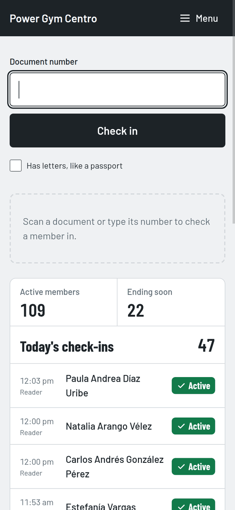
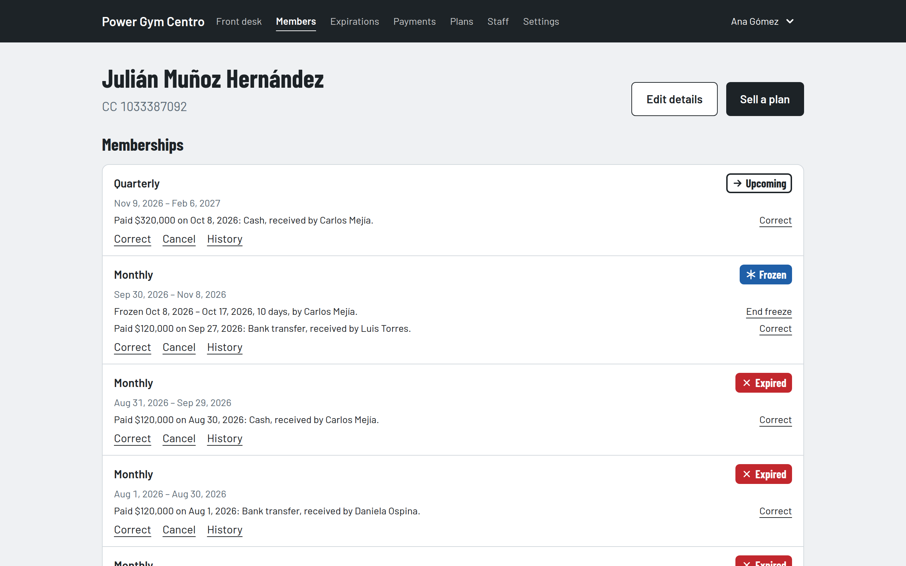
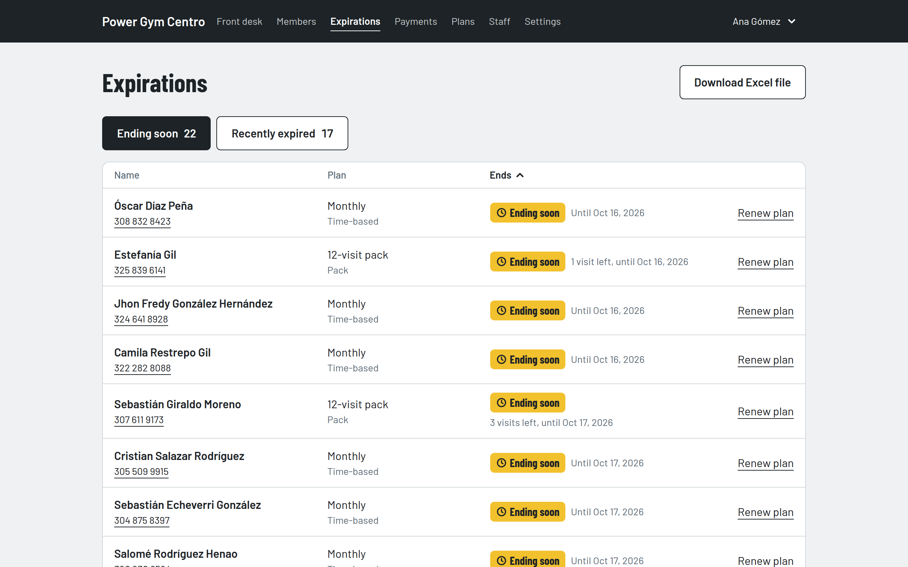
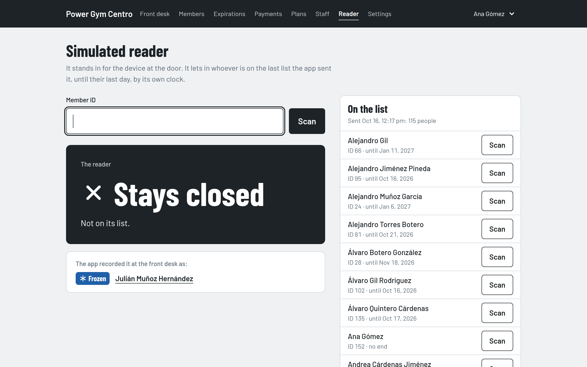

<h1 align="center">Hi, I'm Mateo Del Rio Usma 👋</h1>

  <b>Senior Ruby on Rails Engineer · Tech Lead</b> 
  Backend, PostgreSQL, APIs and Rails upgrades

  
  

## About me

- 💼 6 years building production SaaS with Ruby on Rails, in US healthcare and hospitality.
- 🧭 Tech Lead today: Rails and PostgreSQL architecture, code reviews and mentoring.
- 🔧 What I do best: safe Rails upgrades, slow queries and N+1s, background jobs and APIs.
- 🤖 Integrated an AI model that writes clinical notes on a US healthcare platform, raising insurer acceptance and saving over $90K a month.
- 🎓 Master's in Software Engineering (in progress) and a bachelor's in Marketing, both at Universidad de Medellín.
- 🌎 English (C1) and Spanish (native). Medellín, Colombia (UTC-5).

## Featured project: Gym Membership Manager

Front desk software for small gyms in Colombia, which I built on my own with Rails 8.1 and PostgreSQL 17. It handles members identified by their ID documents, plans and session packs, memberships with freezes, payments, check-in by document number, and an access reader at the door. It's deployed to production.

  

- **Multitenancy**: several gyms share one installation, each with its own staff, roles and settings. acts_as_tenant scopes every query to the current gym, and Pundit authorizes every action.
- **Rules the database enforces**: PostgreSQL exclusion constraints stop overlapping memberships and freezes, even when two sales race, and a partial unique index lets a pack spend one visit a day at most.
- **Privacy by design**: under Colombian Law 1581, biometric data never reaches the app. The reader keeps the fingerprints, and the app only sends it which member IDs may enter and until when, through an `AccessGateway` a real device plugs into.
- **Operations**: deployed with Kamal to a VPS over HTTPS, with nightly backups to Cloudflare R2, a restore I've tested, and errors, uptime and backups watched in Sentry.
- **Tests**: nearly 900 RSpec examples, with Capybara system specs at phone width, run in GitHub Actions along with RuboCop and Brakeman.

| Member page | Expirations | Simulated reader |
|---|---|---|
|  |  |  |

The code is private. If you'd like to read it, [write to me on LinkedIn](https://www.linkedin.com/in/mateo-del-rio-usma/) and I'll share it with you.

## Tech stack

